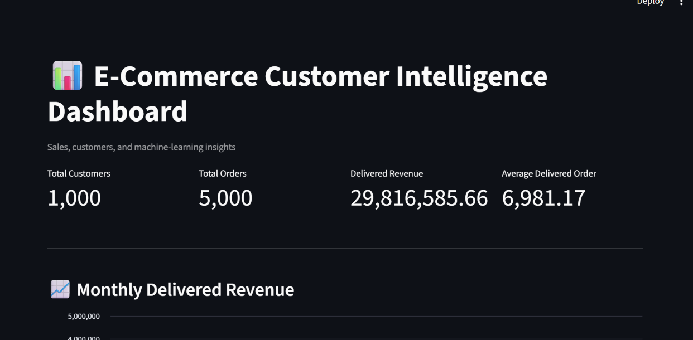

🛒 E-Commerce Customer Intelligence

An end-to-end data analytics and machine learning project that analyzes e-commerce sales, customer behavior, purchasing patterns, and customer activity through an interactive Streamlit dashboard.

📌 Project Overview

This project transforms e-commerce data into useful business insights using Python, SQL, data visualization, and machine learning.

📸 Dashboard Preview


✨ Features

 📊 Interactive Streamlit dashboard
 💰 Monthly delivered revenue analysis
 🛍️ Revenue analysis by product category
 🌍 Regional revenue comparison
 📦 Order status monitoring and order filtering
 👥 RFM-based customer segmentation
 🔍 Customer activity and churn-risk analysis
 🤖 Customer purchase prediction using machine learning
 📈 Model comparison and feature importance analysis
 🗄️ SQLite database and SQL queries

🛠️ Technologies Used

Language: Python
Data Analysis: Pandas
Database: SQLite, SQL
Visualization: Streamlit, Matplotlib
Machine Learning: Scikit-learn, Random Forest, Logistic Regression
Model Storage: Joblib
Control: Git and GitHub

📁 Project Structure

```text
ECommerce-Customer-Intelligence/
├── dashboard/
│   └── app.py
├── data/
│   ├── customers.csv
│   ├── orders.csv
│   ├── products.csv
│   ├── ecommerce.db
│   └── generate_dataset.py
├── ml/
│   ├── churn_analysis.py
│   ├── customer_purchase_prediction.py
│   ├── feature_importance.py
│   ├── model_comparison.py
│   └── rfm_analysis.py
├── notebooks/
├── reports/
└── sql/
    ├── load_database.py
    └── queries.sql
```

🚀 How to Run

1. Clone the repository

```bash
git clone https://github.com/Shivadhaarini/ECommerce-Customer-Intelligence.git
cd ECommerce-Customer-Intelligence
```

2. Install the required packages

```bash
python -m pip install streamlit pandas matplotlib scikit-learn joblib
```

3. Launch the dashboard

```bash
python -m streamlit run dashboard/app.py
```

The dashboard will open in your browser.

📊 Machine Learning

The project includes:

-RFM Analysis: Segments customers based on recency, frequency, and monetary value.
-Customer Activity Analysis: Identifies active customers and customers who may be at risk of inactivity.
-Purchase Prediction: Uses a Random Forest classifier to predict whether a customer has made a delivered purchase.
-Model Comparison: Compares Logistic Regression and Random Forest performance.

*Note: The dataset is synthetic. Model results are for demonstration and learning purposes and may not represent real-world performance.*

🎯 Project Objective

To demonstrate practical skills in data analysis, SQL, dashboard development, customer segmentation, and introductory machine learning through an end-to-end analytics project.

👩‍💻 Author

Shivadhaarini S
B.Tech Information Technology

🔗 GitHub Repository

https://github.com/Shivadhaarini/ECommerce-Customer-Intelligence
